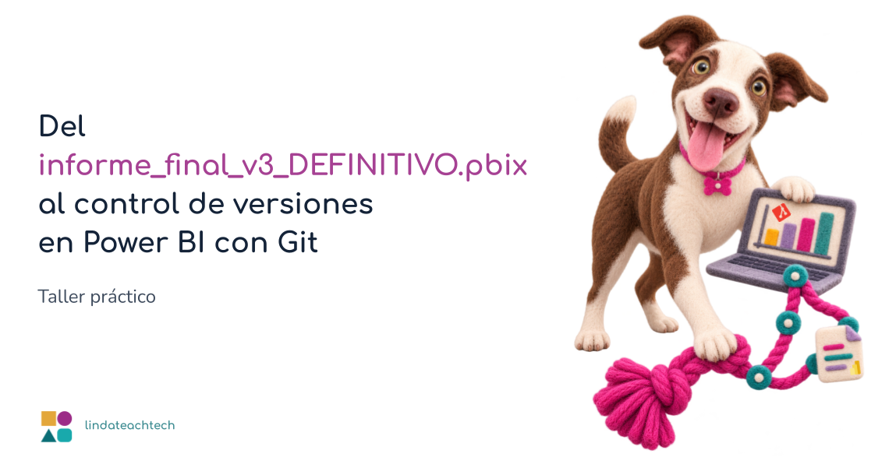

# Del informe_final_v3_DEFINITIVO.pbix al control de versiones en Power BI con Git

Material del taller práctico de la BI Week de la Sociedad Ecuatoriana de Estadística, impartido por Linda Cabrera Orellana el 24 de octubre de 2026.

En el taller aprendemos a guardar un informe de Power BI como proyecto (.pbip) y a versionarlo con Git, GitHub y VS Code: commits, ramas, pull requests y trabajo en equipo.

## Qué hay en este repositorio

- [guia-instalacion.md](guia-instalacion.md): qué instalar antes del taller.
- [comandos-git-taller.md](comandos-git-taller.md): Todos los comandos de Git y los prompts para Claude Code que utilizamos en Taller.
- [ejemplos/](ejemplos/): informes de ejemplo de Power BI para practicar.
- [slides](slides.pdf): slides utilizadas en el Taller.

## Antes de empezar

Necesitas una cuenta de GitHub, Git para Windows, Visual Studio Code y Power BI Desktop. Todos los pasos están en la [guía de instalación](guia-instalacion.md).

## Recursos para seguir aprendiendo

- [Proyectos de Power BI Desktop (Microsoft)](https://learn.microsoft.com/power-bi/developer/projects/projects-overview)
- [Proyectos de Power BI y Git (Microsoft)](https://learn.microsoft.com/power-bi/developer/projects/projects-git)
- [Informes de ejemplo de Microsoft](https://github.com/microsoft/powerbi-desktop-samples)
- [Claude Code en VS Code](https://code.claude.com/docs/en/vscode-extension)
- [Pro Git, libro en español](https://git-scm.com/book/es/v2)
- [Simulador del flujo de control de versiones](https://lindateachtech.netlify.app/blogs/simulador-flujo-control-de-versiones/)

## Taller

## Licencias y créditos

Los informes de la carpeta `ejemplos/` proceden de [microsoft/powerbi-desktop-samples](https://github.com/microsoft/powerbi-desktop-samples), con licencia MIT, © Microsoft Corporation. La licencia está en [ejemplos/LICENSE](ejemplos/LICENSE).

## Contacto

Linda Cabrera Orellana · [lindateachtech.netlify.app](https://lindateachtech.netlify.app) · [GitHub](https://github.com/lindateachtech) · [LinkedIn](https://linkedin.com/in/lindatech)

## Licencia

El material de este taller se comparte bajo licencia [CC BY 4.0](https://creativecommons.org/licenses/by/4.0/deed.es). Puedes usarlo y adaptarlo citando la fuente.
